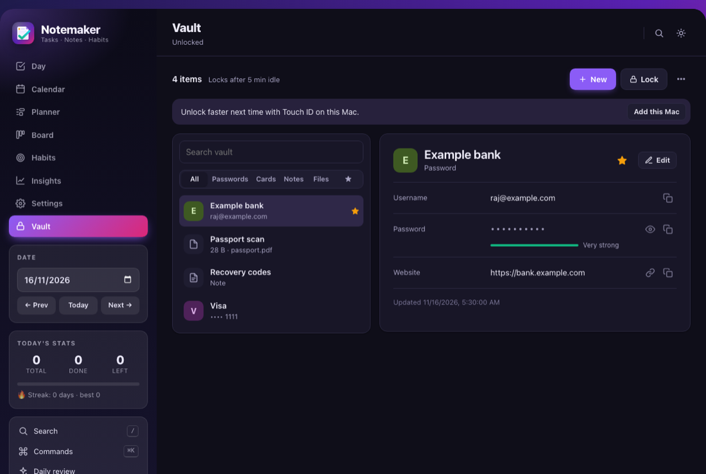

<p align="center"></p>

<h1 align="center">Notemaker</h1>

<p align="center">Daily tasks, notes, habits and a hardware-protected vault —<br>
one app for Mac, Windows, Linux, Android and the browser.</p>

<p align="center">
  
</p>

## Features

**Plan your day**
- Tasks with subtasks, priorities (`!high`), colored `#tags`, notes and drag-to-reorder
- **Quick add** in plain language: `Call Raj tomorrow 3pm #work !high`, `Gym every mon ~2`, `Pay rent every month`
- Recurring tasks (daily, weekdays, weekly, monthly, every N), reminders, smart rollover of unfinished tasks, snooze
- Views: **Day**, **Calendar** (completion heatmap), **Planner** (drag tasks onto an hourly timeline),
  **Board** (To do / Doing / Done), **Habits** (streaks), **Insights** (365-day heatmap, streaks, focus time, top tags)
- **Focus timer** (Pomodoro) per task, **Daily review**, **⌘K command palette**, global search, keyboard shortcuts

**Write**
- Markdown notes per day with toolbar, live preview, tables, `[[YYYY-MM-DD]]` links with backlinks, templates
- Private notes with a passcode (AES-256-GCM)
- Export a day or week as Markdown; full JSON backup / import (the web and Mac apps share one format)

**Vault**: passwords, cards & IDs, secure notes and files, encrypted with a key held in **hardware**
- Mac: the **Secure Enclave** (Touch ID) · Windows: **Windows Hello** (TPM) · Linux: a **USB security key** (FIDO2)
  · Android: the phone's **hardware keystore** (fingerprint / screen lock) · Browser: a **passkey**
- Optional printable **recovery key** to move the vault between devices or recover it
- Password generator, strength meter, copy with clipboard auto-clear, auto-lock

| Setup | Recovery key | Locked | Phone width |
|---|---|---|---|
|  |  |  |  |

---

## Install

Pick your system: [Mac](#option-a-macos-app-recommended-on-a-mac) · [Windows](#option-b-windows) ·
[Linux](#option-c-linux) · [Android](#option-d-android) · [Browser](#option-e-in-the-browser)

Ready-made downloads for every system are on the [**Releases**](https://github.com/more-than-hacking/Notemaker/releases)
page (latest: **v2.5.0**). Every download is free; the apps aren't signed with paid certificates, so Mac and Windows show
a one-time warning (how to get past it is explained below). To confirm a download is genuine:
`gh attestation verify <file> --repo more-than-hacking/Notemaker`.

### Option A: macOS app (recommended on a Mac)

Requires **macOS 14 (Sonoma) or later** and Apple's **Command Line Tools** (full Xcode is *not* needed).

```bash
# 1. Command Line Tools (skip if `xcode-select -p` already prints a path)
xcode-select --install

# 2. Get the code
git clone https://github.com/more-than-hacking/Notemaker.git
cd Notemaker

# 3. Build the app (first build takes a few minutes; later builds ~30 s)
./build.sh

# 4. Install
cp -R build_output/Notemaker.app /Applications/
open /Applications/Notemaker.app
```

Prefer a disk image? `./build_and_create_dmg.sh` creates `Notemaker.dmg`. Open it and drag **Notemaker** to **Applications**.

**First launch**
1. The app is self-signed (not notarized). If macOS says it can't be opened: right-click **Notemaker** → **Open** → **Open**
   (or System Settings → Privacy & Security → **Open Anyway**). Only needed once.
2. Allow **notifications** when asked (Settings → Reminders & notifications) so reminders arrive even when the app is closed.
3. The first time you unlock the vault after installing or rebuilding, macOS may ask to use the keychain.
   Click **Always Allow**.

The app builds for your Mac's architecture (Apple Silicon or Intel). Vault hardware keys need a Mac with a
Secure Enclave (Apple Silicon or a T2 chip); other Macs can still use the vault with a recovery key.

### Option B: Windows

Windows 10 or 11, x64 or ARM.

**Download:** from [Releases](https://github.com/more-than-hacking/Notemaker/releases), take the `.msi`
(x64) or the `-setup.exe` (x64 or ARM) and run it.

**First launch:** the installer isn't code-signed (that costs money), so Windows may show
*"Windows protected your PC"*. Click **More info → Run anyway**. Only needed once.

- The vault uses **Windows Hello** (face, fingerprint or Windows PIN). Set it up first in
  Settings → Accounts → Sign-in options if you haven't.
- Reminders fire while Notemaker is running. Closing the window keeps it in the system tray;
  use **Quit** from the tray icon to really exit.
- The installer registers `.notemaker` files, so double-clicking a transfer file opens it.

**Build from source (optional):** install [Node.js 18+](https://nodejs.org), [Rust](https://rustup.rs) and the
"Desktop development with C++" workload of Visual Studio Build Tools (free). Then in PowerShell:

```powershell
git clone https://github.com/more-than-hacking/Notemaker.git
cd Notemaker\platforms\tauri
npm ci
npx tauri build
# installers: src-tauri\target\release\bundle\msi\  and  ...\bundle\nsis\
```

### Option C: Linux

x86_64 or ARM64 (aarch64), any recent distribution with a desktop.

**Download:** from [Releases](https://github.com/more-than-hacking/Notemaker/releases):

| Your system | File | Install |
|---|---|---|
| Ubuntu, Debian, Mint, Pop!_OS | `.deb` | `sudo apt install ./Notemaker_*.deb` |
| Fedora, RHEL, openSUSE | `.rpm` | `sudo dnf install ./Notemaker-*.rpm` |
| Anything else | `.AppImage` | `chmod +x Notemaker_*.AppImage && ./Notemaker_*.AppImage` |

- The vault's hardware key on Linux is a **USB security key** (YubiKey, SoloKey, Nitrokey, Google Titan,
  any FIDO2 key). You touch it to unlock, and enter its PIN if it has one.
  If Notemaker says it has *no permission* to use the key, install your distribution's FIDO rules
  (`sudo apt install libu2f-udev` on Debian/Ubuntu, `libfido2` on Fedora/Arch) and plug the key in again.
- **No security key?** Use the vault with a recovery key only. It's still encrypted, but nothing physical
  protects it, so keep the recovery key offline and use a strong login password.
- Reminders fire while Notemaker is running (it stays in the tray when you close the window).

**Build from source (optional), Debian/Ubuntu:**

```bash
sudo apt install libwebkit2gtk-4.1-dev libgtk-3-dev libayatana-appindicator3-dev librsvg2-dev \
                 libxdo-dev libssl-dev libudev-dev rpm build-essential curl
curl --proto '=https' --tlsv1.2 -sSf https://sh.rustup.rs | sh      # Rust (skip if installed)
# Node.js 18+ from your package manager or https://nodejs.org
git clone https://github.com/more-than-hacking/Notemaker.git
cd Notemaker/platforms/tauri
npm ci
npx tauri build --bundles deb,rpm,appimage
# packages: src-tauri/target/release/bundle/
```

### Option D: Android

Android 7.0 or later.

**Download:** from [Releases](https://github.com/more-than-hacking/Notemaker/releases) on your phone, open the
`.apk`. Android asks to allow installs from your browser or Files app: **Settings → Allow from this source**, then
**Install**. (Notemaker isn't on the Play Store; an F-Droid listing is planned.)

- The vault key lives in the phone's hardware keystore and opens with your fingerprint, face or screen lock.
  Set up a screen lock first.
- Reminders arrive even when the app is closed. Allow notifications when asked.
- To move from your laptop: in the desktop app use **Move to a New Device…**, copy the `.notemaker` file
  to the phone, and open it with Notemaker.

Building the Android app yourself needs Android Studio's SDK and NDK; see
[`platforms/tauri/README.md`](platforms/tauri/README.md).

### Option E: in the browser

**Quick look**: open `index.html` directly (double-click). Everything works except the vault's passkeys,
which browsers only allow on a real web address.

**Full version (vault + installable app)**: serve the folder locally:

```bash
cd Notemaker
python3 -m http.server 8000
```

Open **http://localhost:8000** in **Safari 18+** or **Chrome 116+**. To install it as an app:
Chrome → address bar **Install** icon · Safari → **File → Add to Dock**.

The vault's passkey must support the PRF extension: iCloud Keychain passkeys (Touch ID), Google Password Manager,
or a FIDO2 security key. If yours doesn't, the app tells you, and you can still open a vault with its recovery key.

---

## Where your data lives

| | Location |
|---|---|
| Mac app | `~/Library/Application Support/Notemaker/data.json` (+ `vault-blobs/` for encrypted vault files) |
| Windows app | `%APPDATA%\com.mth.notemaker\` |
| Linux app | `~/.local/share/com.mth.notemaker/` |
| Android app | The app's private storage (removed if you uninstall; export a backup first) |
| Vault hardware key | Mac: Secure Enclave · Windows: TPM via Windows Hello · Linux: your security key · Android: hardware keystore. It never leaves that hardware |
| Browser | The browser's local storage for this site (+ IndexedDB for encrypted vault files) |

Nothing is sent to any server. **Back up** with **Export backup** (⇧⌘E on Mac, Ctrl+Shift+E on Windows/Linux, Settings → Data everywhere);
the file opens in either app. Data from Notemaker v1 (web or Mac) is migrated automatically on first launch.

## The vault and your security, honestly

- Items, titles and files are encrypted with AES-256-GCM. The key that unlocks them is wrapped by a hardware key
  (Secure Enclave or passkey) and, if you chose it, by your recovery key. **No key is stored in any file, backup or
  server**, so a copied `data.json`, Time Machine backup or export is useless on its own.
- On a Mac, the Secure Enclave key opens with **Touch ID or your Mac login password**, so use a strong Mac password.
- **Store the recovery key offline** (printed, or in another password manager), not as a file next to the vault.
  If you choose *hardware only* and lose the device, the vault cannot be recovered.
- The vault auto-locks after 5 minutes idle (configurable), on sleep and on screen lock. While it is unlocked,
  malware running on your Mac could read it, as with any password manager.
- This is a personal project **without an independent security audit**. The cryptography is tested against shared
  test vectors (`docs/`), but for very high-value secrets prefer an audited password manager.

Formats are documented in [`docs/DATA_FORMAT.md`](docs/DATA_FORMAT.md), [`docs/VAULT_FORMAT.md`](docs/VAULT_FORMAT.md)
and [`docs/DESKTOP_BRIDGE.md`](docs/DESKTOP_BRIDGE.md).

## Keyboard shortcuts

Windows and Linux apps use the Mac shortcuts with **Ctrl** instead of ⌘.

| | Mac app | Browser |
|---|---|---|
| New task | ⌘N | `n` |
| Command palette | ⌘K | Ctrl/⌘ K |
| Search | ⌘F | `/` |
| Today / previous / next day | ⌘T · ⌘[ · ⌘] | `t` · ← · → |
| Switch view | ⌘1 … ⌘8 | `1` … `8` |
| Lock vault | ⇧⌘L | palette → *Lock vault* |
| All shortcuts | Help menu | `?` |

## Troubleshooting

| Problem | Fix |
|---|---|
| `redefinition of module 'SwiftBridging'` while building | Known Command Line Tools issue. `build.sh` detects it and rebuilds with a workaround automatically. |
| *"Notemaker can't be opened"* (Mac) | Right-click → **Open** (self-signed app), once. |
| *"Windows protected your PC"* | **More info → Run anyway** (unsigned installer), once. |
| Linux: "no permission to use the security key" | Install FIDO udev rules (`libu2f-udev` / `libfido2`), replug the key. |
| Android: "App not installed" | Uninstall an older Notemaker built with a different key first (export a backup before). |
| Reminders don't appear | Allow notifications for Notemaker in System Settings → Notifications. |
| Vault says passkeys aren't available (browser) | Use `http://localhost:8000` (not `file://`) in Safari 18+ / Chrome 116+. |
| Vault: "This vault was created on another device" | Unlock with the recovery key, then choose **Add this Mac / PC / phone / security key**. |
| Start over (Mac) | Quit Notemaker and move `~/Library/Application Support/Notemaker/data.json` away. |

## Development

```bash
node --test tests-web/                    # web tests (Node 20+)
./Tests-mac/run.sh                        # macOS core + crypto tests (no Xcode needed)
./build.sh && build_output/Notemaker.app/Contents/MacOS/Notemaker --bridge-selftest   # native bridge self-test
```

The UI is plain HTML/CSS/JS (`index.html`, `styles.css`, `app.js`, `js/`) with no build step and no dependencies.
The Mac app (`Notemaker/Shell/`) is an AppKit window with a WKWebView that loads the same files and adds native
features through a small bridge. See [`SETUP.md`](SETUP.md) for the source layout and debugging flags, and
[`INSTALL_INSTRUCTIONS.md`](INSTALL_INSTRUCTIONS.md) for more install details.

## License

[MIT](LICENSE) © 2026 More-Than-Hacking (MTH). The app icon is original artwork included under the same license.
